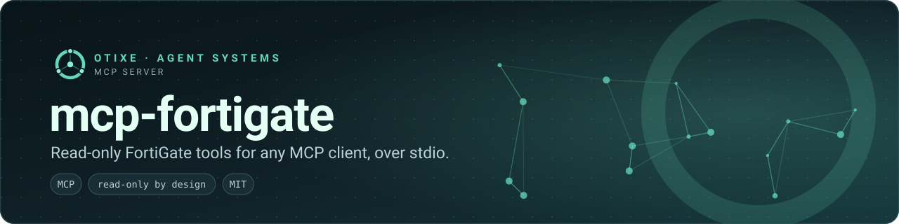
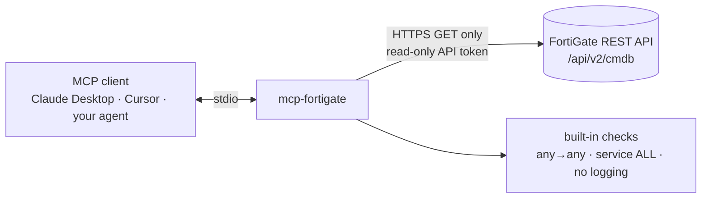
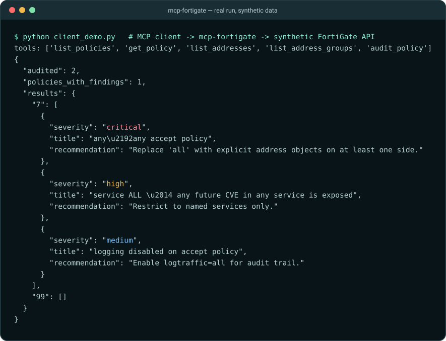

<p align="center">
  
</p>

<p align="center">
  <a href="https://github.com/otixe/mcp-fortigate/actions/workflows/ci.yml"></a>
  <a href="LICENSE"></a>
  
  
  
</p>

**An [MCP](https://modelcontextprotocol.io) server that lets an agent inspect and audit FortiGate configuration.** Five configuration-read tools, `GET` requests only; no configuration-write tool is implemented.

## The problem

Giving a conversational agent access to a firewall is attractive (ask "which policies allow ALL services from broad subnets?") and risky. A server that merely *promises* to be careful is not the same as one that has no write path at all.

## The approach



| Tool | Purpose |
| --- | --- |
| `list_policies` | Policies with id, name, action, status, sources, destinations, services. |
| `get_policy` | One policy in full. |
| `list_addresses` | Address objects. |
| `list_address_groups` | Address groups. |
| `audit_policy` | Run the direct-risk checks on one policy (`policy_id`) or on all of them. |

The HTTP client implements only `GET`: there is no `set`, `edit` or `delete` code path to misuse. Defence in depth still applies on the device — give the API user a read-only admin profile and restrict it to the host running this server (see [SECURITY.md](SECURITY.md)).

## See it run

An MCP client starts the server, lists its tools and calls `audit_policy` against a **synthetic** FortiGate API (two invented policies on localhost):

<p align="center">
  
</p>

<sub>Terminal capture: an MCP client lists the five tools and audits two synthetic policies; policy 7 yields critical, high and medium findings.</sub>

## Quickstart

Python 3.10+. Not on PyPI yet:

```bash
pip install "git+https://github.com/otixe/mcp-fortigate.git"
export FORTIGATE_HOST=firewall.example.com
export FORTIGATE_TOKEN=...            # a read-only API token
export FORTIGATE_VDOM=root            # optional, default root
mcp-fortigate                         # speaks MCP over stdio
```

Optional: `FORTIGATE_VERIFY=false` disables TLS verification for lab devices (on by default).

Claude Desktop (`claude_desktop_config.json`) or any client that launches stdio servers:

```json
{
  "mcpServers": {
    "fortigate": {
      "command": "mcp-fortigate",
      "env": {
        "FORTIGATE_HOST": "firewall.example.com",
        "FORTIGATE_TOKEN": "your-readonly-token",
        "FORTIGATE_VDOM": "root"
      }
    }
  }
}
```

Then ask: *"Audit the firewall for policies that grant ALL services from broad subnets, and suggest least-privilege replacements."* The agent calls `list_policies`, then `audit_policy`, and reports.

## Scope and limits

- The built-in checks are the **direct** ones (any→any accept, service `ALL`, logging disabled). Indirect "umbrella" exposure analysis is not implemented here.
- The token’s actual permissions must be restricted on the device. No real FortiGate authentication, permission enforcement or device behavior was validated; the demos and tests use synthetic responses.
- Needs the `mcp` Python SDK **1.x** (`mcp>=1.0,<2`); the server uses the 1.x decorator API.
- Tool results are returned as JSON text.

## An honest note on MCP at scale

Five tools are cheap to expose directly. A platform with dozens of tools should not load every definition into every request; that is the motivation for [AMA](https://github.com/otixe/pi-oficinas), which keeps a small stable direct set and reaches the rest through a code sandbox.

## Part of the Otixe agent platform

Otixe builds persistent, accountable agent teams: **Pi** (runtime) → **Oficinas** (persistent teams) ↔ **Cerebro** (shared memory and work state) ↔ **Sinapsis** (web control surface), with **AMA** connecting the runtime to Cerebro.

A worked example of a deliberately narrow MCP surface: few tools, one direction of data flow, no write path.

[Otixe profile](https://github.com/otixe) · [Platform manual](https://github.com/otixe/plataforma) · [pi-oficinas](https://github.com/otixe/pi-oficinas)

## Validation

See [VALIDATION.md](VALIDATION.md) for the local Python matrix, reproducible checks and unproven integration boundaries. GitHub Actions has not been run by this delivery.

## License

MIT — see [LICENSE](LICENSE).
